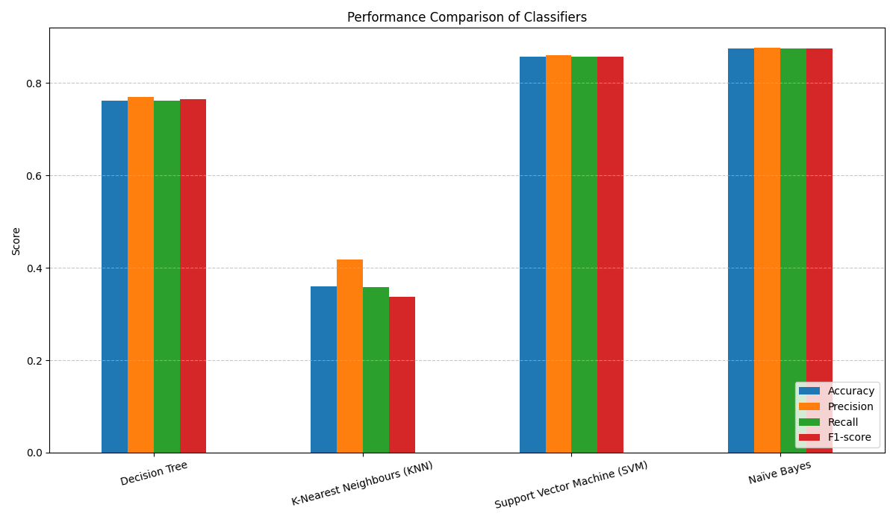
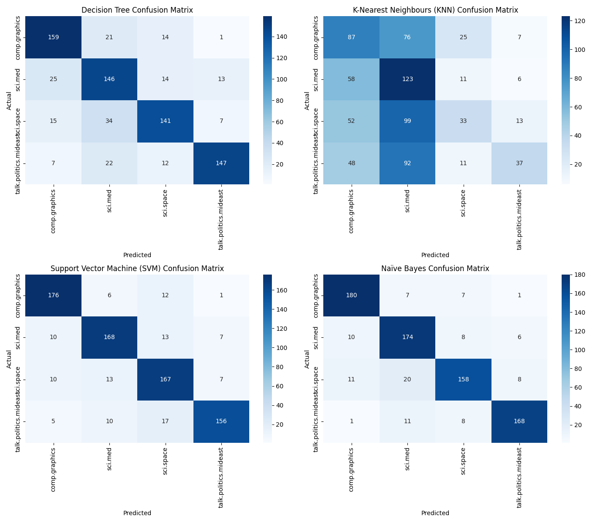

# Text Classification Comparative Study

A comparative study evaluating multiple Machine Learning classifiers (Decision Tree, KNN, Support Vector Machine, and Naïve Bayes) on the 20 Newsgroups text dataset.

---

## 📌 Table of Contents
1. [Introduction](#-introduction)
2. [Dataset & Classes](#-dataset--classes)
3. [Project Pipeline](#-project-pipeline)
4. [Results & Evaluation](#-results--evaluation)
5. [What-If Experiment](#-what-if-experiment)
6. [How to Run](#-how-to-run)
7. [Technologies Used](#-technologies-used)

---

## 📖 Introduction
This project performs a comparative text classification study to investigate the performance of various statistical and machine learning architectures on categorized newsgroup articles. By employing TF-IDF vectorization, text documents are represented as high-dimensional vectors to optimize classification accuracy across diverse domains.

## 📊 Dataset & Classes
The study utilizes a subset of the benchmark **20 Newsgroups dataset** consisting of the following four distinct categories:
* `comp.graphics`
* `sci.med`
* `sci.space`
* `talk.politics.mideast`

**Data Preprocessing:**
To ensure our classifiers learn from the actual content and avoid overfitting on metadata headers or user signatures, we programmatically removed:
* Headers
* Footers
* Quotes
* Standard English stop words

---

## 🛠️ Project Pipeline
1. **Data Ingestion:** Fetching subset categories via scikit-learn.
2. **Feature Extraction:** Constructing TF-IDF numeric matrices restricted to 2,500 maximum features.
3. **Validation Strategy:** Stratified 80/20 Train-Test partitioning to maintain class distributions.
4. **Model Training:** Training Decision Tree, KNN, Linear SVM, and Multinomial Naïve Bayes classifiers.
5. **Model Evaluation:** Metric calculations (Accuracy, Macro Precision, Macro Recall, and Macro F1-score) and Confusion Matrix generation.

---

## 📈 Results & Evaluation

### Metrics Summary Table

| Algorithm | Accuracy | Precision (Macro) | Recall (Macro) | F1-Score (Macro) |
| :--- | :---: | :---: | :---: | :---: |
| **Naïve Bayes (Multinomial)** | **87.40%** | **87.57%** | **87.44%** | **87.43%** |
| **Support Vector Machine (Linear)** | **85.73%** | **85.99%** | **85.71%** | **85.78%** |
| **Decision Tree** | 76.22% | 77.01% | 76.26% | 76.46% |
| **K-Nearest Neighbours (KNN)** | 35.99% | 41.76% | 35.79% | 33.67% |

### Visualizations
All generated evaluation plots can be found in the repository root:
* **Performance Bar Chart (`performance_comparison.png`):**
  
* **Confusion Matrices Heatmaps (`confusion_matrices.png`):**
  

---

## 🔬 What-If Experiment
We performed a hyperparameter tuning test by changing the SVM classifier kernel parameter from `linear` to non-linear Radial Basis Function (`rbf`):
* **Linear SVM F1-score:** 85.78%
* **RBF SVM F1-score:** 87.59%

**Observation:** Shifting to an RBF kernel resulted in a minor performance uplift, suggesting that projecting the text relationships non-linearly allows for a slightly improved separation of target newsgroup domains.

---

## 🚀 How to Run

### 1. Clone the repository:
```bash
git clone https://github.com/roshanarputharaj2607-tech/Information_retrieval.git
cd Information_retrieval
```

### 2. Install dependencies:
```bash
pip install -r requirements.txt
```

### 3. Run the pipeline:
```bash
python main.py
```

---

## 💻 Technologies Used
* **Language:** Python 3
* **Libraries:** Scikit-Learn, Pandas, NumPy, Matplotlib, Seaborn
